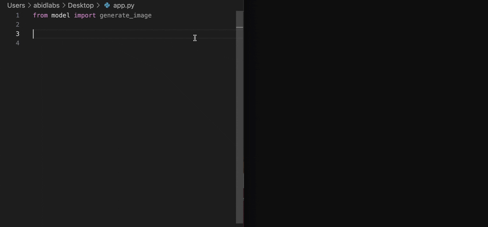
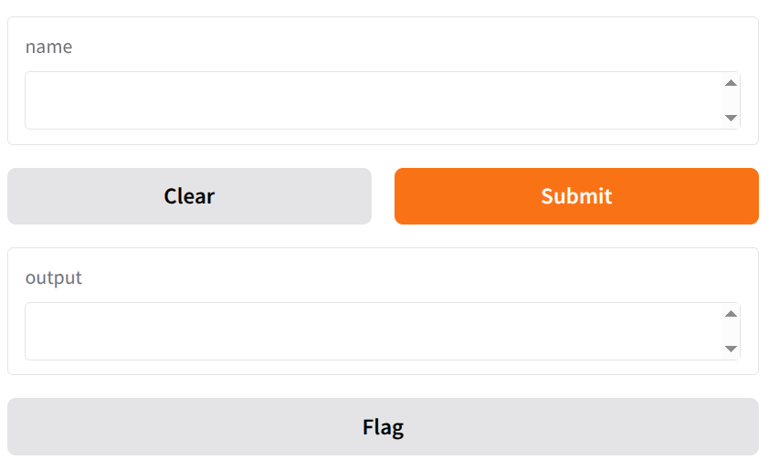
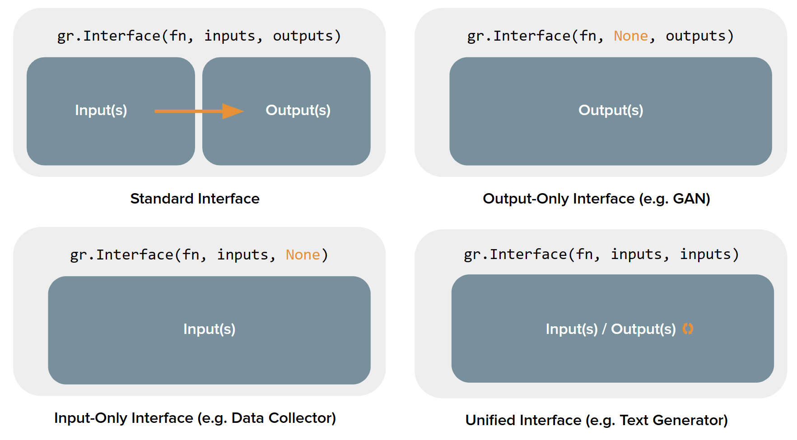

Машинное обучение применяется во многих сферах — от бизнеса до медицины, но большая часть моделей по-прежнему (и изначально) работает в виде скриптов или Jupyter-ноутбуков. Чтобы провести тестирование работы модели, показать её заказчикам, сделать демо модели нужен простой визуальный интерфейс. Веб-интерфейс решает эти задачи.

Причём для быстрого создания таких интерфейсов не требуется написания HTML, JS и CSS кода. Все эти рутинные действия, необходимые для создания интерфейсов из типовых элементов, выполняют специальные библиотеки.


# Библиотеки для создания UI

Самые популярные библиотеки, которые особенно удобно использовать для создания веб-интерфейса для приложений на основе ML.


| Библиотека | Популярность | Простота | Возможности | Деплой и шаринг | Гибкость интерфейса | Интеграция с ML | Документация | Для чего лучше всего |
| --- | --- | --- | --- | --- | --- | --- | --- | --- |
| **Gradio**  | **GitHub:** ~40.2k ★ / 3.1k ⑂; **PyPI:** ~9.55M загрузок/мес. | Очень просто — минимальный код, готовые виджеты; отлично для быстрых демо. | Виджеты для ML I/O (картинки, аудио, текст), быстрый просмотр моделей. | Мгновенные публичные ссылки, Hugging Face Spaces, встраивание в ноутбуки. | Простейший UI для демо; для кастомного сложного UI придётся дописывать. | Нативная поддержка моделей (HF, Torch, sklearn) и примеры. | Много туториалов и шаблонов; хорошая доступность для новичков. | Быстрое демонстрирование/проверка ML-моделей, интерактивные демо. |
| **Streamlit** | **GitHub:** ~41.8k ★ / 3.8k ⑂; **PyPI:** ~16.86M загрузок/мес. | Очень просто для большинства задач; API декларативный — легко стартовать. | Широкие возможности по кастомизации интерфейса, поддержка навигации, внешний JS/компоненты через компоненты. | Streamlit Cloud, легко CI/CD, много интеграций. | Гибкий — много UI-компонентов, можно использовать кастомный JS через API. | Удобно интегрировать модели; экосистема компонентов для визуализации. | Официальная и большая документация; много примеров/сообщества. | Прототипы, визуализация данных, внутренние инструменты исследователей и аналитиков. |
| **Dash (Plotly Dash)** | **GitHub:** ~24.2k ★ / 2.2k ⑂; **PyPI:** ~5.04M загрузок/мес. | Требует больше кода и архитектурных решений; подразумевает понимание callbacks. | Очень гибкий для дашбордов, сложных визуализаций; поддержка кастомного JS/HTML. | Любой Flask-friendly хостинг; хорошая поддержка крупного деплоя и корпоративных сценариев. | Наибольшая гибкость при комплексных UI (React под капотом), но выше порог. | Готовые компоненты под ML/визуализацию; хорошо подходит для аналитики. | Документация большая и ориентирована на серьёзные дашборды и примеры. | Сложные корпоративные дашборды, BI-проекты и аналитические приложения. |
| **Reflex** | **GitHub:** ~26k ★ / 1.5k ⑂; **PyPI:** пакет `reflex` (релиз 06 Oct 2025); детальные агрегаты скачиваний на момент сбора были недоступны/неоднозначны. | Всё на Python; API стремится быть простым, но концепция full-stack (frontend+backend) добавляет сложности для новичков. | Можно строить полноценные сервисы: страницы, state-модель, компоненты; быстро вырастают в full-stack app. | Есть Reflex Cloud (хостинг/деплой), опции on-prem. | Полная кастомизация, но требует привыкания к парадигме (всё в Python). | Можно строить любые пайплайны и интерфейсы; пока экосистема моложе, чем у Streamlit/Gradio. | Можно интегрировать ML, но нет множества ready-made ML-виджетов (как у Gradio). | Документация и примеры быстро растут, но сообщество моложе — материалы есть на сайте и в репозитории. Full-stack Python-приложения без JS (полноценные web-apps, internal tools, AI apps с деплоем). |
| **Taipy** | **GitHub:** ~18.8k ★ / 1.9k ⑂; **PyPI (taipy-core):** ~11.8k загрузок/мес. | Немного выше порог входа, особенно при продакшн-потребностях; визуальный дизайнер упрощает некоторые сценарии. | Мощная оркестрация и what-if-анализы, сценарные эксперименты, пайплайны. | Поддержка развёртывания на серверах, планировщики, корпоративные фичи. | UI ориентирован на аналитические сценарии; Designer/Studio дают low-code подход, но ручная кастомизация сложнее. | Хорош для оркестрации экспериментов, сценариев и production-pipelines; интеграция ML на уровне процессов. | Документация фокусируется на корпоративных кейсах и пайплайнах; есть официальные туториалы. | Аналитика «что-если», сценарные эксперименты, production-ориентированные data/ML apps. |


# Gradio
Фреймворк **[Gradio](https://www.gradio.app/)** — отличный старт для знакомства с ML UI: максимально прост (минимум кода), нативно интегрирован с библиотеками для ML, идеально подходит чтобы быстро и наглядно показать модель — с возможностью быстро поделиться с другими. При этом не требуется изучения основ веб-разработки.




Как устроен:
- Использует собственный встроенный HTTP-сервер, который запускается незаметно для разработчика.
- Single-Page Application (SPA). Все интерактивные действия обрабатываются без перезагрузки страницы. После первичной загрузки ресурсы — компоненты UI (текстовые поля, кнопки, слайдеры, изображения) и JS-логика — остаются на клиенте.
- Клиенты отправляют данные в JSON формате, сервер обрабатывает и отвечает тоже JSON с результатами.
- Использует асинхронную обработку запросов и event-loop.
- Можно интегрировать Gradio с FastAPI для расширенного контроля и масштабирования.

Фреймворк разрабатывается компанией Hugging Face, которая развивает открытую платформу и сообщество для работы с моделями ML.

Преимущества:
- быстрая установка и запуск;
- простота;
- поддержка большинства ML-библиотек;
- понятная документация;
- возможность запустить и поделиться приложением через браузер в один клик (или выгрузить в Hugging Face Spaces, если нужно постоянное публичное демо).


**Ссылки**
* Песочница с запуском кода - https://www.gradio.app/playground
* Quickstart - https://www.gradio.app/guides/quickstart

*API Gradio заметно менялся после 2023 года в версиях 4–6 (переименования параметров, новые компоненты, перенос настроек темы в `launch()`), поэтому старые примеры из неофициальных материалов могут не работать. Актуальная версия — Gradio 6.31 (октябрь 2026)*

**Пример**
```py
import gradio as gr


def greet(name):
    return "Hello " + name + "!"


demo = gr.Interface(fn=greet, inputs="text", outputs="text")

if __name__ == "__main__":
    demo.launch()
```




## Компоненты

Основные понятия
* Компонент — элемент интерфейса (например, текстовое поле, загрузка файла, график), с которым пользователь может взаимодействовать.
* Входные компоненты — элементы интерфейса, через которые пользователь вводит данные.  эквивалентны аргументам функции.
* Выходные компоненты — Элементы интерфейса, отображающие данные. Эквивалентны возвращаемым значениям функции.
* Компоновщик — специальный класс, позволяющий создавать страницу или вкладку с набором компонентов.


**Компоновщики**
* `Interface` — это высокоуровневый компоновщик
    - Обычно соответствует одной веб-странице с простым UI.
    - Удобный, простой способ описать одностраничное приложение (SPA).
    - Создаёт типичную форму из входных и выходных компонентов.
    - Настройка интерфейса ограничена главным образом набором входных и выходных компонентов и их порядком.
    - Подходит, если нужно быстро создать веб-прототип без сложного макета.

    Для этого компоновщика создаётся функция-обработчик. Аргументы функции - список входных компонентов, возвращаемый результат должен соответствовать выходным компонентам.

* `Blocks` — низкоуровневый и более гибкий компоновщик
    - Позволяет создавать страницы с произвольной структурой (несколько колонок, строк, вкладок и др.).
    - Позволяет строить многоэтапные приложения с логикой переходов, событиями (onclick, onchange), сложным взаимодействием компонентов.
    - Программист определяет где и как компоненты располагаются, чем они связаны и когда вызываются функции.
    - Можно делать полноценные веб-страницы со сложными интерфейсами, разбитыми на вкладки, секции, “аккордеоны” и др.





Справочник компонентов в Gradio: https://www.gradio.app/docs/gradio/


### Входные компоненты (input components)

**Способы создания компонентов**

1. Краткое указание типа компонента в виде строки
    ```py
    import gradio as gr

    def greet(name):
        return f"Привет, {name}!"

    demo = gr.Interface(fn=greet, inputs="text", outputs="text")
    demo.launch()
    ```
2. Создание экземпляров соответствующих классов компонентов
    ```py
    import gradio as gr

    def greet(name):
        return f"Привет, {name}!"

    demo = gr.Interface(
        fn=greet,
        inputs=gr.Textbox(lines=2, placeholder="Введите ваше имя", label="Имя пользователя"),
        outputs=gr.Textbox(label="Приветствие")
    )
    demo.launch()
    ```

**Списки компонентов**
Можно передавать сразу список компонентов в параметрах inputs и outputs при создании интерфейса (например, `inputs=['text', 'slider']`). Это создаст форму с несколькими полями ввода в указанном порядке, которая будет передавать данные функции как несколько отдельных аргументов.

Аналогично можно использовать списки и для компонентов, создаваемых как объекты: 
```py
inputs=[gr.Textbox(label="Ввод"), gr.Slider(minimum=0, maximum=10)]
```

#### 1. **Textbox**

- **Описание**: Обычное текстовое поле для ввода строки.
- **Применение**: Ввод параметра, вопроса, ключа, имени.
- **Пример**:
  ```python
  import gradio as gr

  def greet(name):
      return f"Привет, {name}!"

  gr.Interface(greet, gr.Textbox(label="Введите имя"), gr.Textbox(label="Приветствие")).launch()
  ```
- [Документация Textbox](https://www.gradio.app/docs/gradio/textbox)

#### 2. **Number / Slider**

- **Описание**: Числовой ввод; Slider — удобно для диапазонов.
- **Применение**: Ввод параметров модели, настройка гиперпараметров.
- **Пример**:
  ```python
  def square(x):
      return x**2

  gr.Interface(square,
               gr.Slider(minimum=0, maximum=100, label="Число"),
               gr.Textbox(label="Квадрат")).launch()
  ```
- [Документация Slider](https://www.gradio.app/docs/gradio/slider)

#### 3. **Checkbox / Radio**

- **Описание**: Выбор булевого значения или одного из нескольких вариантов.
- **Применение**: Включение опций, переключение режимов.
- **Пример**:
  ```python
  def mode(use_bonus):
      return "Режим: бонус" if use_bonus else "Режим: стандартный"

  gr.Interface(mode, gr.Checkbox(label="Включить бонус"), gr.Textbox(label="Выбранный режим")).launch()
  ```
- [Документация Checkbox](https://www.gradio.app/docs/gradio/checkbox)
- [Документация Radio](https://www.gradio.app/docs/gradio/radio)

#### 4. **File / Image**

- **Описание**: Загрузка файла или картинки (через drag&drop).
- **Применение**: Использование изображений, аудио, .csv для теста модели.
- **Пример**:
  ```python
  def image_shape(img):
      import PIL.Image
      image = PIL.Image.open(img)
      return image.size

  gr.Interface(image_shape,
               gr.Image(type="filepath", label="Загрузите изображение"),
               gr.Textbox(label="Размер")).launch()
  ```
- [Документация Image](https://www.gradio.app/docs/gradio/image)

#### 5. **Dropdown**

- **Описание**: Выпадающий список.
- **Применение**: Классический выбор категорий — например, выбрать тип задачи или алгоритм.
- **Пример**:
  ```python
  def select_algo(algo):
      return f"Выбран алгоритм: {algo}"

  gr.Interface(select_algo,
               gr.Dropdown(choices=["Linear", "Tree", "SVM"], label="Алгоритм"),
               gr.Textbox(label="Результат")).launch()
  ```
- [Документация Dropdown](https://www.gradio.app/docs/gradio/dropdown)

***

### Выходные компоненты (output components)

#### 1. **TextBox / Label**

- **Описание**: Для отображения текста или метки.
- **Применение**: Вывод предсказания, комментария, вероятностей.
- **Пример**:
  ```python
  def predict_age(name):
      # "Модель" — просто пример
      return f"Возраст {name}: 25 лет"

  gr.Interface(predict_age, gr.Textbox(label="Имя"), gr.Label(label="Предсказание возраста")).launch()
  ```
- [Документация Label](https://www.gradio.app/docs/gradio/label)

#### 2. **Plot**

- **Описание**: Для вывода графиков (matplotlib, plotly, seaborn).
- **Применение**: Визуализация результатов регрессии, распределения, метрик.
- **Пример (matplotlib)**:
  ```python
  def make_plot(a, b):
      import matplotlib.pyplot as plt
      fig, ax = plt.subplots()
      ax.plot([0, 1], [a, b])
      return fig

  gr.Interface(make_plot, [gr.Number(label="A"), gr.Number(label="B")], gr.Plot()).launch()
  ```
- [Документация Plot](https://www.gradio.app/docs/gradio/plot)

#### 3. **Image**

- **Описание**: Показывает изображение.
- **Применение**: Воспроизведение результата сегментации, генерации, предсказания.
- **Пример**:
  ```python
  def invert(img):
      from PIL import Image, ImageOps
      image = Image.open(img)
      inverted = ImageOps.invert(image.convert("RGB"))
      return inverted

  gr.Interface(invert, gr.Image(type="filepath", label="Исходное изображение"), gr.Image(label="Инвертированное изображение")).launch()
  ```
- [Документация Image](https://www.gradio.app/docs/gradio/image)

#### 4. **Dataframe**

- **Описание**: Таблицы (например, pandas.DataFrame).
- **Применение**: Отображение таблиц результатов, списков входных данных, метрик.
- **Пример**:
  ```python
  def show_df(file):
      import pandas as pd
      # В Gradio 4+ компонент File возвращает путь к файлу (строку), а не объект с атрибутом .name
      df = pd.read_csv(file)
      return df.head()

  gr.Interface(show_df, gr.File(label="CSV файл"), gr.Dataframe(label="Таблица")).launch()
  ```
- [Документация Dataframe](https://www.gradio.app/docs/gradio/dataframe)


### Привязка компонентов к модели и функции

В Gradio каждый компонент — это точка передачи данных в Python-функцию. Программист задаёт:
- какие компоненты на вход (например, gr.Textbox, gr.Image);
- какие на выход (например, gr.Label, gr.Plot).

**Пример интерфейса для sklearn.linear_model.LinearRegression:**
```python
from sklearn.linear_model import LinearRegression
import gradio as gr
import numpy as np
# для примера тут приведено обучение модели, но готовая модель должна загружаться из файла
model = LinearRegression()
X = np.array([[1], [2], [3], [4]])
Y = np.array([2, 4, 6, 8])
model.fit(X, Y)

# Принимает число, выводит предсказание
def predict(x):
    return float(model.predict([[x]]))

gr.Interface(
    fn=predict,
    inputs=gr.Number(label="Значение X"),
    outputs=gr.Number(label="Оценка Y")
).launch()
```

***

## Blocks — для более сложных сценариев

Если нужно сделать интерфейс из нескольких компонентов, управлять макетом, строить последовательности действий (например, загрузка файла → выбор параметра → обработка), стоит использовать Gradio Blocks:
- **Row, Column, Tab** — компоненты для организации интерфейса.
- **Event handling** — можно связывать кнопки (“on_click”) с обработкой.

**Пример: две вкладки — предсказание и график**
```python
import gradio as gr
from sklearn.linear_model import LinearRegression
import numpy as np
import matplotlib.pyplot as plt

model = LinearRegression()
X = np.array([[1],[2],[3],[4]])   # обучающая выборка: один признак X
Y = np.array([2,4,6,8])           # целевая переменная Y = 2*X
model.fit(X,Y)                    # обучаем модель один раз при старте приложения

def predict(x):
    # x приходит как число из компонента gr.Number
    # predict() ждёт 2D-массив (n_samples, n_features), поэтому [[x]]
    return float(model.predict([[x]]))

def plot():
    # функция без входов; возвращает matplotlib-фигуру —
    # gr.Plot умеет отображать её напрямую, без сохранения в файл
    fig, ax = plt.subplots()
    ax.scatter(X, Y)                          # исходные точки
    ax.plot(X, model.predict(X), color="red") # линия регрессии
    return fig

with gr.Blocks() as demo:
    # Вкладка 1: ввод числа -> предсказание модели
    with gr.Tab("Предсказание"):
        inp = gr.Number(label="X")            # входной компонент
        out = gr.Number(label="Y")            # выходной компонент
        btn = gr.Button("Сделать предсказание")
        # привязка события: при клике вызвать predict(inp) и записать результат в out
        btn.click(predict, inp, out)
    # Вкладка 2: кнопка -> построение графика
    with gr.Tab("График"):
        plot_btn = gr.Button("Построить график")
        plot_area = gr.Plot()                 # контейнер для отображения фигуры
        # входов нет (None), выход — компонент Plot
        plot_btn.click(plot, None, plot_area)

demo.launch()
```

Базовая документация Blocks: [https://www.gradio.app/docs/gradio/blocks](https://www.gradio.app/docs/gradio/blocks)


### Отображение LaTeX
LaTeX рендерится компонентом `gr.Markdown` (и `gr.Chatbot`) — рендеринг на фронтенде через KaTeX, ничего дополнительно ставить не нужно.

- Строчная формула: `$E = mc^2$`; выносная: `$$\int_0^1 x^2 dx = \frac{1}{3}$$`
- В Python-строках используйте raw-строки (`r"$$\frac{1}{2}$$"`), иначе `\f`, `\n` и т.п. будут интерпретированы как спецсимволы.
- Если разделитель не рендерится, задайте его явно через параметр `latex_delimiters`:
  ```py
  gr.Markdown(
      "Inline: $x^2$, block: $$x^2$$",
      latex_delimiters=[
          {"left": "$", "right": "$", "display": False},
          {"left": "$$", "right": "$$", "display": True},
      ],
  )
  ```
- Формула может быть результатом функции: функция возвращает строку с LaTeX, а выходной компонент — `gr.Markdown`.

### Советы по работе с компонентами

- Задавайте метки (`label`) у каждого компонента — помогает понять, что требуется пользователю.
- Используйте `type`, при работе с файлами или изображениями (например, `type="filepath"`), чтобы избежать ошибок.
- Для сложных форм из нескольких полей воспользуйтесь Blocks (см. выше). Можно собрать нужную структуру интерфейса с помощью Row, Column, Tab и других layout-компонентов.


**Ссылки на документацию и справочники:**
- Список всех компонентов Gradio: [https://www.gradio.app/docs/gradio/](https://www.gradio.app/docs/gradio/)
- Blocks: [https://www.gradio.app/docs/gradio/blocks](https://www.gradio.app/docs/gradio/blocks)
- Основные туториалы: [https://www.gradio.app/guides/quickstart](https://www.gradio.app/guides/quickstart)
- Готовые демо-примеры: [https://github.com/gradio-app/gradio/tree/main/demo](https://github.com/gradio-app/gradio/tree/main/demo)


## Запуск сервера
#### Метод `launch()`
Метод `launch()` — ключевой метод для любого созданного с помощью Gradio интерфейса или Blocks-приложения. Он запускает локальный веб-сервер, который обслуживает браузер и организует взаимодействие пользователя с Python-функцией (например, с ML-моделью).


Основная задача `launch()`
- Запустить HTTP-сервер на локальной машине (обычно по адресу http://localhost:7860), чтобы открыть в браузере интерфейс.
- Организовать обмен данными с браузером: принимать входные из UI, вызывать обработчики на Python, возвращать результаты.
- Поддержать асинхронный интерактивный обмен без перезагрузки страницы (через AJAX).


**Параметры**
- `share` (bool, по умолчанию False):
  - Если True, создает публичную временную ссылку через собственный туннель Gradio (`https://xxxx.gradio.live`), доступную из интернета.
  - Удобно чтобы быстро поделиться демо; требует подключения к сети.

- `inbrowser` (bool):
  - Автоматически открывает интерфейс в браузере после запуска.

- `server_name` и `server_port`:
  - Позволяют задать IP-адрес и порт для локального сервера.
  - Например `server_name="0.0.0.0"` позволяет принимать запросы из сети (не только localhost).

- `debug`:
  - Включение подробного логирования.

- `inline`:
  - Для Jupyter/Colab — встраивает интерфейс прямо в ячейку ноутбука (по умолчанию включается автоматически в ноутбуках).

- `prevent_thread_lock`:
  - Позволяет запускать интерфейс без блокировки основного потока Python, полезно при работе в некоторых средах.

- `theme=gr.themes.Monochrome()` — [тема оформления](https://www.gradio.app/guides/theming).
  - **Важно (Gradio 6):** параметры уровня приложения (`theme`, `css`, `js`, `head`) перенесены из конструктора `gr.Blocks()` в метод `launch()`. В Gradio 5 и ранее они задавались в конструкторе:
    ```py
    # Gradio 5.x (старый способ)
    demo = gr.Blocks(theme=gr.themes.Soft())

    # Gradio 6.x (актуальный способ)
    demo = gr.Blocks()
    demo.launch(theme=gr.themes.Soft())
    ```

**Связанные методы и инструменты**
- `.close()` — останавливает запущенный сервер.
- `.queue()` — активирует очередь вызовов функций, полезно при обработке тяжелых задач.
- `gr.mount_gradio_app()` — позволяет встроить интерфейс Gradio в другое ASGI-приложение (например, FastAPI), для размещения на кастомных путях.
  - *ASGI-приложение* — Python-сервер, построенный на асинхронном стандарте ASGI (FastAPI, Starlette): он принимает HTTP-запросы и раздаёт страницы/API. Gradio сам является таким приложением, поэтому его можно «встроить» внутрь другого — например, чтобы на одном сервере работали и  REST API и демо с веб-интерфейсом.


**Запуск общедоступного интерфейса**
- Самый простой способ сделать совместный доступ — это вызвать `launch(share=True)`.
- Gradio создаёт туннель через собственный прокси-сервер, генерируя уникальный публичный URL вида `https://xxxx.gradio.live`.
- Ограничения / особенности:
  - Ссылка временная: активна только пока работает процесс и истекает через неделю.
  - Не используйте `share=True` для приложений с чувствительными данными — ссылка доступна любому, у кого она есть. Для ограничения доступа используйте параметр `auth`.
  - Может появиться небольшая задержка из-за туннелирования.
  - Подходит для демонстраций, но не для продакшена.


**Пример**
```python
import gradio as gr

def greet(name):
    return "Hello " + name + "!"

demo = gr.Interface(fn=greet, inputs="text", outputs="text")
demo.launch(share=True, inbrowser=True)
```


## Работа без интернета
Gradio умеет работать полностью локально, но по умолчанию делает несколько обращений в сеть. Что именно грузится и как это отключить:

- **Аналитика и проверка версии** — при запуске приложение отправляет данные об использовании на серверы Hugging Face и проверяет свежую версию на PyPI.
  - Отключение: переменная окружения `GRADIO_ANALYTICS_ENABLED="False"` (задать **до импорта** gradio) или параметр `analytics_enabled=False` в `gr.Interface` / `gr.Blocks`.
- **Шрифты из Google Fonts** — тема по умолчанию загружает шрифты `Source Sans Pro` и `IBM Plex Mono` с `fonts.googleapis.com`.
  - В офлайн-среде или при медленном соединении браузер ждёт ответа CDN , страница может долго загружаться.
  - Решение: указать системные шрифты в теме (строка вместо `gr.themes.GoogleFont(...)`):
    ```py
    demo.launch(theme=gr.themes.Default(font=["Arial", "sans-serif"], font_mono=["Consolas", "monospace"]))
    ```
- **Функции, требующие интернет по определению:** `share=True`, `gr.load()` (загрузка интерфейса со Space или модели с Hugging Face Hub).

Сам фронтенд (JS/CSS) входит в pip-пакет и раздаётся локальным сервером, поэтому интерфейс по `localhost` открывается без CDN.

Пример полностью офлайн-запуска:
```python
import os
os.environ["GRADIO_ANALYTICS_ENABLED"] = "False"  # до импорта gradio

import gradio as gr

def greet(name):
    return "Hello " + name + "!"

demo = gr.Interface(fn=greet, inputs="text", outputs="text")
demo.launch(
    theme=gr.themes.Default(font=["Arial", "sans-serif"], font_mono=["Consolas", "monospace"]),
    inbrowser=True,
)
```


## Обработка ошибок и ввода
- Gradio не предоставляет полноценной проверки ошибок(как в обычных веб-формах)
- Можно создавать свои обработчики событий в Blocks для проверки и блокировки дальнейших шагов

Если переданные в функцию данные некорректны (например, деление на ноль, неверный формат или значение), то бросайте [исключение типа](https://www.gradio.app/docs/gradio/error) `gr.Error`. Например:
```py
raise gradio.Error("An error occurred 💥!", duration=5)
```

Это отобразит всплывающее сообщение на форме.
См. также:
- `gr.Info("Starting process")`
- `gr.Warning("Name is empty")`


### Flag
Кнопка "Flag" — это встроенный механизм Gradio для обратной связи от пользователя:
- Позволяет отметить текущий ввод и результат как неправильные или проблемные.
- Обычно используется для сбора ошибок модели, неправильных предсказаний или проблем с UI.
- На сервер отправляются данные текущего запуска (входы, выходы, ID сессии).
- Данные сохраняются в лог-файлы в каталоге `flagging_dir` (по умолчанию `.gradio/flagged`); формат определяется `flagging_callback` (по умолчанию `gr.JSONLogger`).

Вы можете подключить обработчик для сбора отмеченных данных. Gradio сохраняет их в указанную папку (flagging_dir) автоматически.

Пример

```python
demo = gr.Interface(fn=greet, inputs="text", outputs="text", flagging_dir="flags")
demo.launch()
```


Параметры, связанные с Flag в `gr.Interface`

- `flagging_mode`: по умолчанию `"manual"` (показывать кнопку Flag и ждать, пока пользователь нажмёт).
  - Можно поставить `"auto"` — все примеры автоматически флагируются (кнопка не показывается).
  - Или `"never"` — кнопка не показывается и ничего не флагируется.
  - **Важно (Gradio 4+):** параметр `allow_flagging` переименован в `flagging_mode`. В старых примерах встречается старое имя.
- `flagging_dir`: путь к каталогу для сохранения логов флагирования (по умолчанию `.gradio/flagged`).
- `flagging_options`: список строк (например, `["Incorrect", "Ambiguous"]`) для выбора категории флага.
  - Если не задано — пользователь просто нажимает кнопку без выбора категории. Работает только при `flagging_mode="manual"`.
- `flagging_callback`: позволяет задать свой callback-класс для обработки флагов (наследуется от `FlaggingCallback`; по умолчанию `gr.JSONLogger`).


## См. также

- Официальная документация: [https://www.gradio.app/docs](https://www.gradio.app/docs)
- Гайды и туториалы: [https://www.gradio.app/guides](https://www.gradio.app/guides)
- Гайд по миграции на Gradio 6: [https://www.gradio.app/guides/gradio-6-migration-guide](https://www.gradio.app/guides/gradio-6-migration-guide)
- Размещение на Hugging Face Spaces: [https://huggingface.co/docs/hub/spaces-sdks-gradio](https://huggingface.co/docs/hub/spaces-sdks-gradio)
- Исходный код и демо-примеры: [https://github.com/gradio-app/gradio](https://github.com/gradio-app/gradio)
- https://www.gradio.app/guides/view-api-page - Встроенный API
